<div align="center">

# ⚡ StackMatch — Planning Studio

**Plan smarter. Choose better. Build with confidence.**

An editorial, AI-assisted product planning platform and architecture studio that helps founders, engineers, and technical teams turn concepts into production-ready engineering blueprints.

[](LICENSE)
[](https://www.typescriptlang.org/)
[](https://react.dev/)
[](https://vitejs.dev/)
[](https://nodejs.org/)
[](https://expressjs.com/)
[](https://tailwindcss.com/)
[](https://www.mongodb.com/)

**Created and maintained by [Manish](https://github.com/manishvenki)**  
[Repository](https://github.com/manishvenki/stackmatch) • [Bug Report](https://github.com/manishvenki/stackmatch/issues) • [Feature Request](https://github.com/manishvenki/stackmatch/issues)

---

### [Features](#-core-features) • [Screenshots](#-product-showcase) • [Architecture](#-architecture) • [Tech Stack](#-technology-stack) • [Quickstart](#-quickstart--local-development) • [Status](#-verified-feature-status) • [Roadmap](#-upcoming-roadmap)

</div>

---

## 💡 About StackMatch

**StackMatch** is an AI-assisted project planning platform that helps developers turn an idea into a structured development plan. Define requirements, explore suitable technologies, understand the architecture, build a roadmap, and organize the work into an executive project blueprint.

From napkin-sketch concepts to validated delivery roadmaps, StackMatch replaces fragmented spreadsheets, disconnected architecture diagrams, and guesswork with an integrated planning studio.

---

## ⚠️ Active Status Notices

> [!WARNING]
> ### 🟡 In Progress — AI Chat
> The **AI Chat** feature is currently under active development. Integration and reliability improvements with upstream LLM providers are still being finalized. While conversation states, draft restoration, and graceful fallback recovery modals are active, live model generation may fail or fall back depending on your configured environment keys.

> [!NOTE]
> ### 🔵 Coming Soon — Connect with Freelancers
> The **Connect with Freelancers** experience is planned for an upcoming release. The current studio displays preview tiles and workflow integration points. Dedicated marketplace profiles, direct matching, and escrow contracting will launch in a future milestone.

---

## 🌟 Core Features

- **🎯 Natural Language Idea Scoping:** Describe your vision in plain English. The studio extracts functional and non-functional requirements, constraints, assumptions, and complexity drivers.
- **📊 Deterministic Tech Stack Suitability Scoring:** Evaluate candidates against project constraints (scalability, ACID compliance, real-time latency) with transparent percentage match scores (90%+).
- **🏗️ 3-Tier System Topography & Consistency Engine:** Visual modeling of Client, API Gateway, and Storage layers paired with automated architecture health checks (e.g., 94% Consistency Score).
- **🗓️ Phased Delivery Roadmaps:** Milestone-driven timelines divided into Foundation, Core Workflows, Architecture Polish, and Production Launch.
- **📄 Multi-Page Executive Blueprint Engine:** Instant client-side PDF export with vector typography, page-break calculation, branded headers, and executive summaries.
- **🛡️ Centralized Error Handling & Recovery:** Detects network interruptions, quota exhaustion, and service timeouts with reassuring rotating quotes and draft preservation.
- **🎨 Hand-Drawn Animated Doodle System:** SVG underline, spark, connector arrows, and full-screen orbital loading choreography designed in StackMatch's neutral editorial palette.

---

## 📸 Product Showcase

All screenshots below represent the authentic, verified application running in local development:

### 1. Editorial Landing Page & Interactive Studio
The redesigned landing page pairs editorial SaaS typography (`#111827`, `#2563EB`, `#F9FAFB`) with an animated SVG doodle system and an interactive 5-tab Hero Planning Studio.

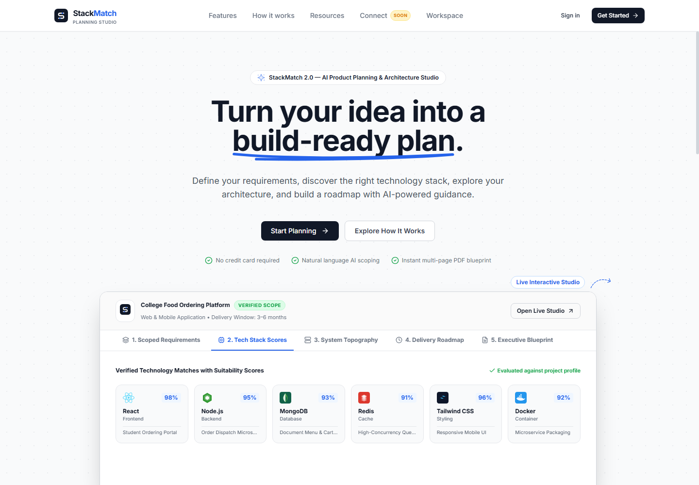


---

### 2. Authenticated Dashboard & Project Hub
Manage multiple active concepts, monitor stage progressions, inspect active project metrics, and access one-click project creation.

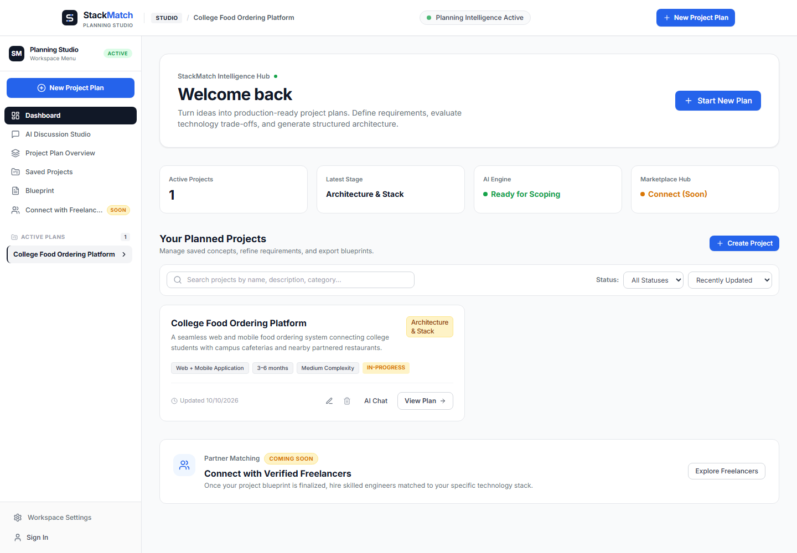

---

### 3. Scoped Requirements & Project Planning Workflow
Granular requirements matrix organizing functional, operational, and non-functional requirements with priority badges and editing controls.

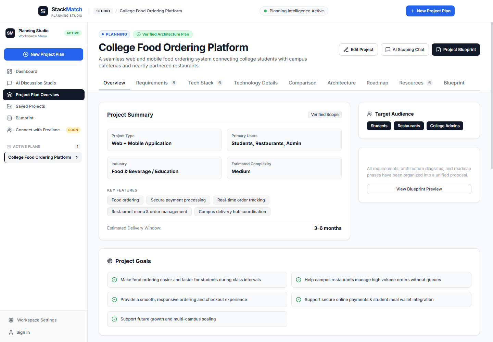

---

### 4. Verified Technology Stack & Fit Scoring
Technology trade-off evaluation featuring match scores (91%–98%), architectural roles, rationale tags, and alternative options.

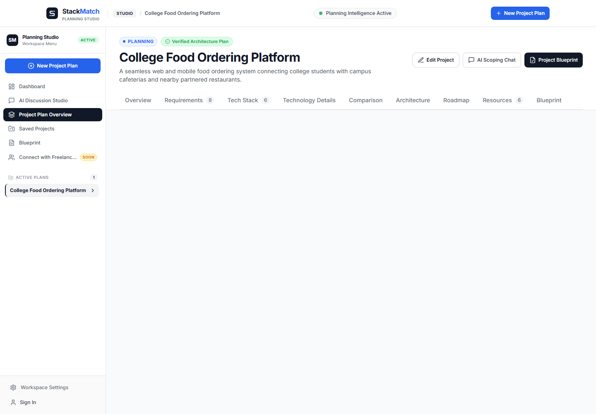

---

### 5. 3-Tier Architecture Topography
Tiered component communication models (Web/Mobile Clients → Express API Gateway → PostgreSQL/MongoDB/Redis Storage) with live architecture health checks.

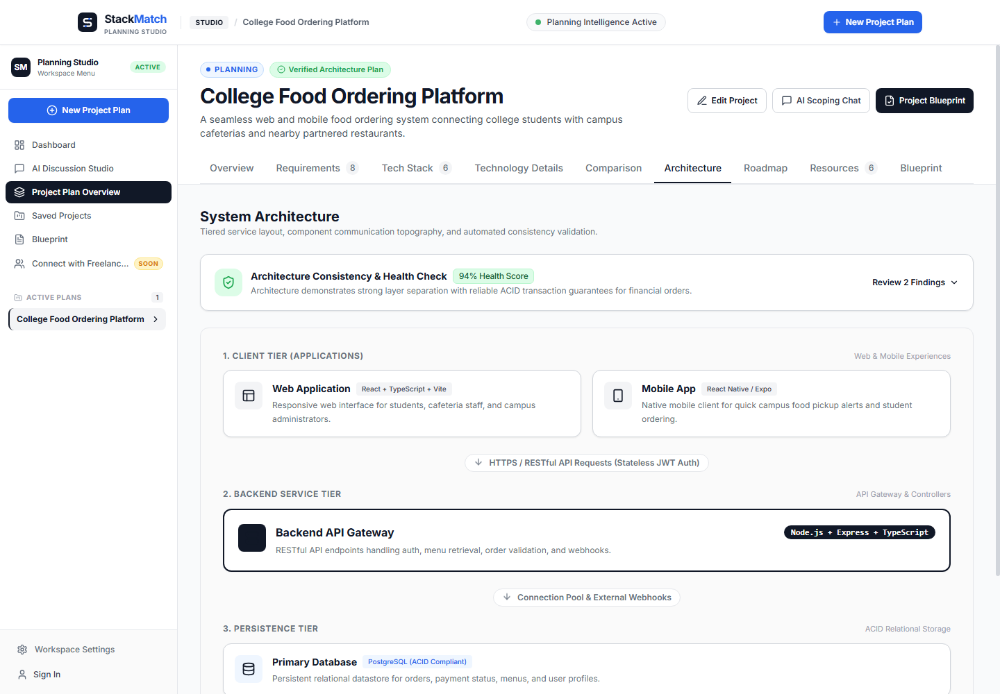

---

### 6. Executive Engineering Blueprint
Full dynamic engineering blueprint organizing executive summaries, objectives, tech stack, architecture topography, and operational checklists.

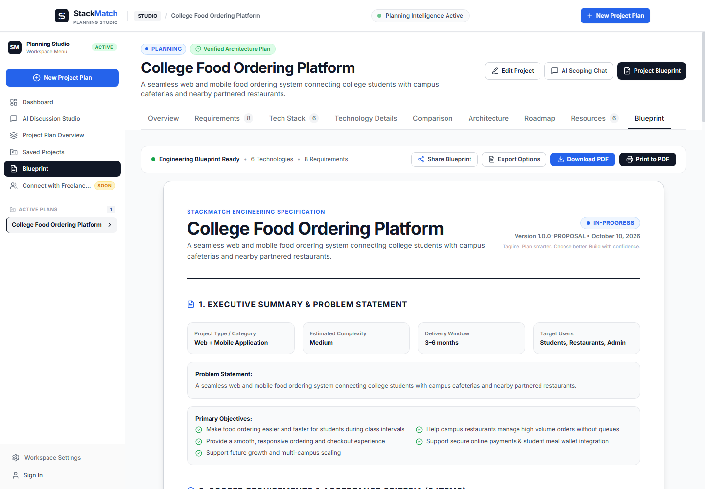

---

### 7. Multi-Page PDF Export Engine
Export production-grade PDF blueprints directly from the browser with vector text and multi-page layout balancing.

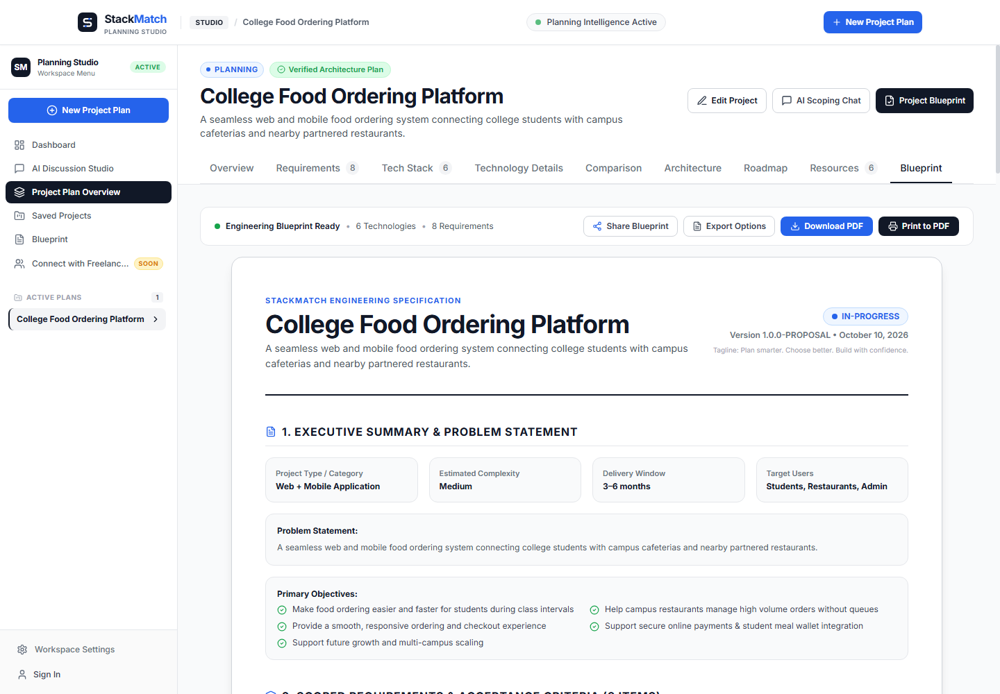

---

### 8. AI Planning Discussion Studio *(In Progress)*
Interactive conversational planning studio with stage detection, structured follow-up questions, and draft message recovery.

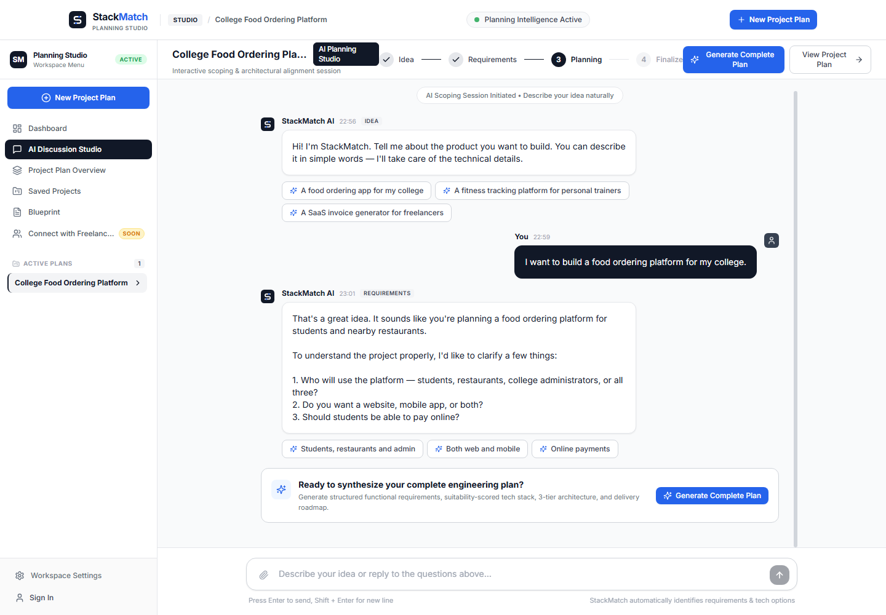

---

### 9. Secure Authentication Flow
Clean, split-screen authentication forms for registration and sign-in with client-side validation and JWT session handling.

| Sign In Screen | Registration Screen |
|:---:|:---:|
| 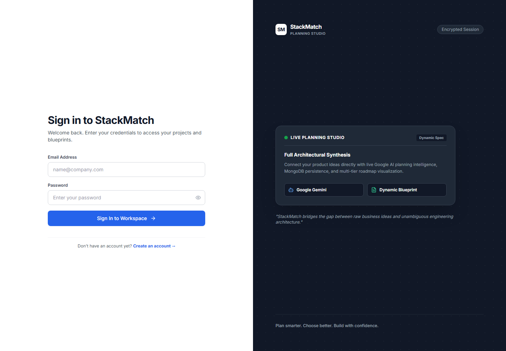 | 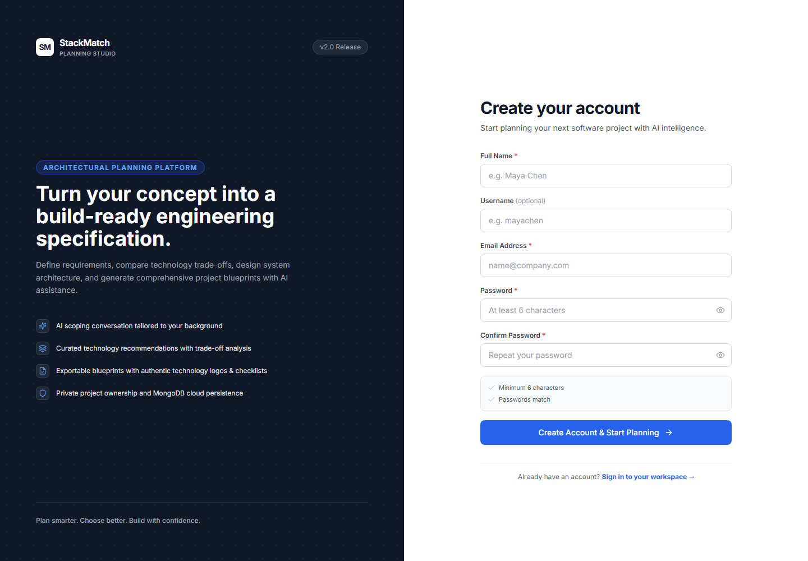 |

---

### 10. Responsive Mobile Experience
Full viewport responsiveness across all mobile device breakpoints with fluid typography and zero horizontal scroll.

<div align="center">
  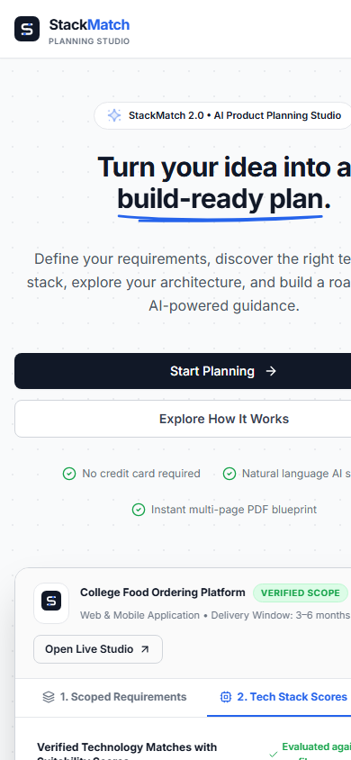
</div>

---

## 🏛️ Architecture

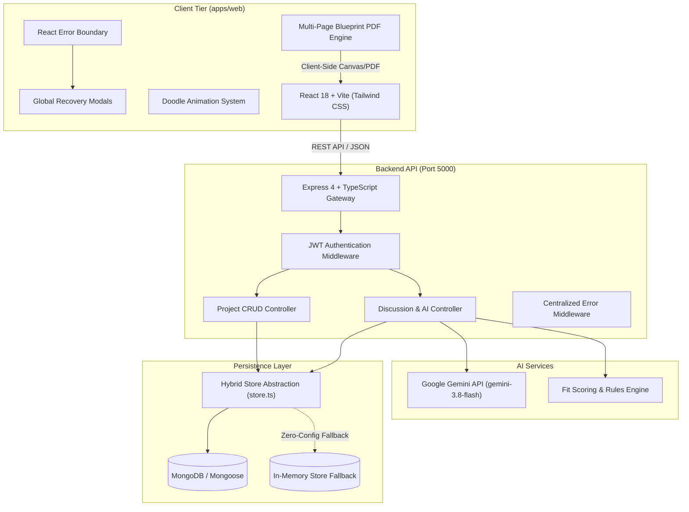

---

## 💻 Technology Stack

| Layer | Technologies | Description |
|---|---|---|
| **Frontend** | React 18, Vite 5, TypeScript | Single-page application with modular routing and instant HMR. |
| **Styling & Icons** | Tailwind CSS 3, Lucide React | Curated neutral color palette, micro-interactions, and vector icons. |
| **Motion & Doodles** | SVG Stroke Dash, CSS Keyframes | Hand-drawn animated underlines, connectors, sparks, and orbit loaders. |
| **Document Export** | html2canvas, jsPDF | Multi-page client-side PDF document generation. |
| **Backend API** | Node.js 20+, Express 4, TypeScript | Modular REST API with typed controllers and centralized error handling. |
| **Authentication** | JSON Web Tokens (JWT), Bcrypt.js | Stateless bearer authentication with salted password hashing. |
| **Database** | MongoDB, Mongoose 8 | Document storage with automatic in-memory fallback for zero-config setups. |
| **AI Intelligence** | Google Gemini API (`gemini-3.8-flash`) | Conversational scoping, follow-up generation, and prompt analysis. |
| **Monorepo Tooling** | npm Workspaces, tsx | Unified orchestrator script (`run.js`) for concurrent multi-tier execution. |

---

## 🚀 Quickstart & Local Development

### 1. Prerequisites
- **Node.js**: v18.0.0+ (v20+ recommended)
- **npm**: v9.0.0+
- **MongoDB**: Optional (StackMatch automatically activates an in-memory store if MongoDB is not running locally).

### 2. Clone & Install
```bash
# Clone the repository
git clone https://github.com/manishvenki/stackmatch.git
cd stackmatch

# Install all workspace dependencies
npm install
```

### 3. Configure Environment Variables
```bash
# Copy root environment configuration
cp .env.example .env

# Copy backend environment configuration
cp backend/.env.example backend/.env
```

Edit `.env` or `backend/.env` to configure your settings (e.g., set `GEMINI_API_KEY` from [Google AI Studio](https://aistudio.google.com/)).

### 4. Start the Application
Boot the full monorepo concurrently using the unified runner:

```bash
# Runs types compiler, backend API (port 5000), and Vite frontend (port 5173)
node run.js
```

Or run via npm:
```bash
npm run dev
```

Visit **`http://localhost:5173`** in your browser.

---

## ⚙️ Environment Variables

| Variable | Scope | Purpose | Default / Example |
|---|---|---|---|
| `PORT` | Backend | HTTP port for Express server | `5000` |
| `NODE_ENV` | Backend | Application environment mode | `development` |
| `CLIENT_URL` | Backend | Allowed CORS origin for web app | `http://localhost:5173` |
| `MONGODB_URI` | Backend | MongoDB connection string | `mongodb://localhost:27017/stackmatch` |
| `JWT_SECRET` | Backend | Secret key for signing session tokens | `your-secret-key-min-32-chars` |
| `JWT_EXPIRES_IN` | Backend | Lifetime of session tokens | `7d` |
| `GEMINI_API_KEY` | Backend | Google AI Studio Gemini API Key | `your-google-gemini-key` |
| `GEMINI_MODEL` | Backend | Active Gemini model | `gemini-3.8-flash` |
| `VITE_API_BASE_URL` | Frontend | Optional API proxy target | `/api/v1` (via Vite proxy) |

---

## 📊 Verified Feature Status

| Feature | Status | Notes |
|---|---|---|
| **Editorial Landing Page** | Verified & Active | Responsive typography, animated doodle system, interactive hero tabs. |
| **Full-Screen Doodle Loader** | Verified & Active | Viewport-covering SVG orbital loader with graceful dismissal. |
| **Authentication Flow** | Verified & Active | Registration, login, JWT validation, salted password hashing. |
| **Project CRUD** | Verified & Active | Create, edit, delete, and switch projects with state persistence. |
| **Requirements Matrix** | Verified & Active | Functional/non-functional categorization and inline editing. |
| **Tech Stack Recommendations** | Verified & Active | Fit scoring percentages, candidate trade-offs, and architecture notes. |
| **3-Tier Architecture Topography** | Verified & Active | Tier visualizer, communication conduits, and health score validator. |
| **Delivery Roadmap Engine** | Verified & Active | Phased milestone timeline and deliverable breakdown. |
| **Executive Blueprint** | Verified & Active | Dynamic multi-section document synthesis. |
| **Multi-Page PDF Download** | Verified & Active | Browser-rendered vector PDF downloads with sanitized filenames. |
| **Offline Mode & Recovery** | Verified & Active | Connectivity detection, sticky offline banner, and recovery modals. |
| **AI Planning Chat** | 🟡 **In Progress** | Conversation UI and draft recovery verified; upstream model tuning ongoing. |
| **Connect with Freelancers** | 🔵 **Coming Soon** | Studio integration tiles active; marketplace launching in future update. |

---

## 📂 Repository Structure

```text
stackmatch/
├── apps/
│   └── web/                     # React 18 + Vite frontend
│       ├── src/
│       │   ├── components/      # Doodles, Layout, Chat, Domain, UI components
│       │   ├── context/         # GlobalErrorContext, NetworkStatusContext
│       │   ├── pages/           # Landing, Dashboard, Overview, Chat, Auth pages
│       │   ├── services/        # ApiClient, errorMapper, mockData
│       │   └── utils/           # pdfExport, quotes, retryRequest
│       └── package.json
├── backend/                     # Express + TypeScript backend API
│   ├── src/
│   │   ├── config/              # Environment config and model settings
│   │   ├── controllers/         # Auth, Project, and Message controllers
│   │   ├── middleware/          # JWT auth and centralized errorHandler
│   │   ├── models/              # Mongoose schemas (User, Project, Blueprint)
│   │   └── services/            # geminiService, aiPlanningService, store
│   └── package.json
├── packages/
│   └── types/                   # Shared TypeScript interfaces monorepo package
│       └── src/index.ts
├── docs/
│   ├── screenshots/             # Authentic application screenshots
│   └── architecture.mmd         # Mermaid system topography source
├── scripts/
│   ├── capture-all-screenshots.js # Puppeteer/Chrome automated screenshot suite
│   ├── test-error-mapper.mjs    # Error mapping and retry unit tests
│   └── verify-landing-page.js   # Landing page visual verification script
├── run.js                       # Monorepo unified multi-tier runner
├── .env.example                 # Root environment template
├── CONTRIBUTING.md              # Contribution guidelines
├── LICENSE                      # ISC License
└── package.json                 # Monorepo workspaces manifest
```

---

## 🗺️ Upcoming Roadmap

- [ ] **AI Chat Pipeline Stabilization:** Streaming response support, enhanced token budgeting, and multi-turn context compression.
- [ ] **Live Workspace Collaboration:** Real-time multi-user cursor alignment on requirements matrices.
- [ ] **Export Enhancements:** Markdown and OpenAPI 3.0 export options directly from the blueprint toolbar.
- [ ] **Freelancer Marketplace Hub:** Direct matching with verified contract engineers based on the exact recommended tech stack.
- [ ] **Self-Hosted Docker Image:** Single-container Docker deployment for private on-premise planning studios.

---

## 👨‍💻 Creator & Credits

Created and maintained with ❤️ by **[Manish](https://github.com/manishvenki)**  
GitHub: [@manishvenki](https://github.com/manishvenki)  
Repository: [https://github.com/manishvenki/stackmatch](https://github.com/manishvenki/stackmatch)

### Acknowledgements
- [Lucide Icons](https://lucide.dev/) for vector UI icons.
- [Vite](https://vitejs.dev/) for lightning-fast frontend bundling.
- [Tailwind CSS](https://tailwindcss.com/) for utility styling.
- [Google AI Studio](https://aistudio.google.com/) for Gemini models.

---

## 📄 License

This project is licensed under the **ISC License** — see the [LICENSE](LICENSE) file for details.
